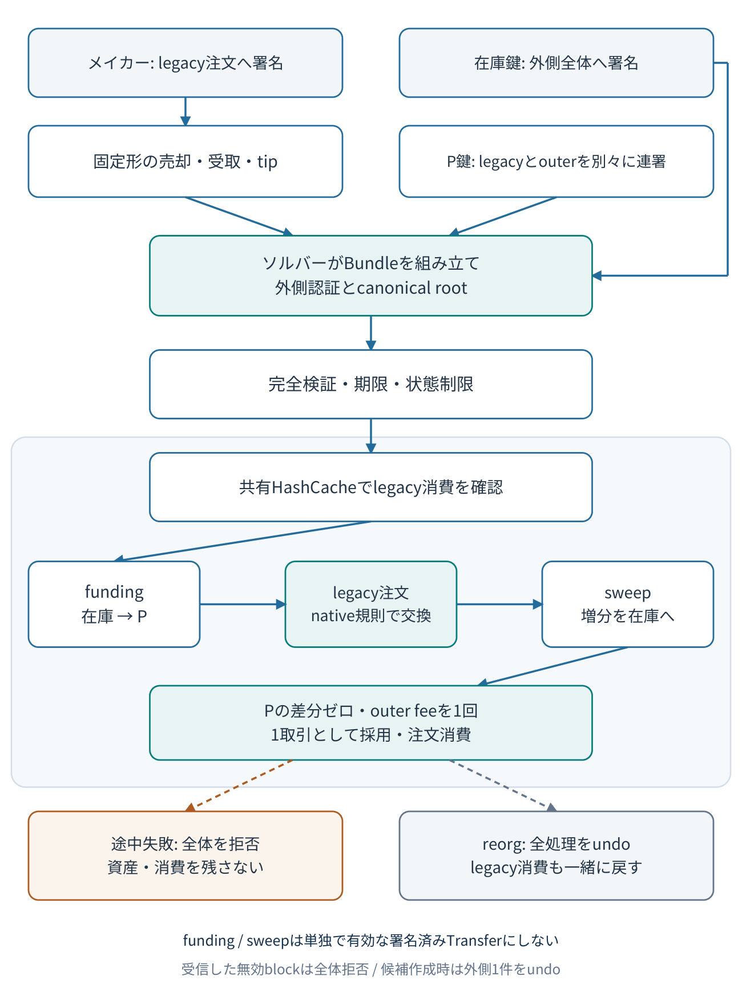

# AtomicBundle v1 設計書 — 既存署名済み注文を使う DEX 限定 PoC

> 2026-10-26 詳細仕様追加（文書版0.2、wire versionは1のまま）: [ABI台帳](poc/atomic-bundle/protocol-abi.md)、[実行契約](poc/atomic-bundle/execution-spec.md)、[配置案](repository-layout.md)、[受入表](acceptance-matrix.md)。実装・native照合は未実施。

## 文書の位置付け

これは**実装・実行・安全性実証をまだ行っていない設計仕様**である。対象は、新規 genesis から起動する隔離された private chain のみ。公開ネットワークへの接続、実資産の投入、mainnet の更新・移行は対象外とする。共通条件は [共通仕様](00-common-spec.md)、実装手順は [Codex 指示書](../codex/atomic-bundle-task.md) を参照する。

| 対象 | 固定する版 |
|---|---|
| Symbol / catapult の基準 | `symbol/symbol@6c04695555230c89a6ffa2ac4d41774dcac77ae3` |
| 既存注文形式の参照 | `HinaBlogChannel/heika@891a2cb17a0d52c85ed85594d8283c844481a6cb` の `examples/intent-dex` |
| 新機能 | `AtomicBundle`、wire version 1、DEX 用の固定形のみ |

以下の新しい型名・設定名は設計上の提案であり、既存 Symbol API ではない。公開 EntityType の数値は割り当てない。実装の M0 で既存型・もう一方の PoC と衝突しない実験用値を決め、schema とテストの一箇所に定義する。



図の編集用: [Mermaidソース](../diagrams/atomic-bundle.mmd) / [SVG](../diagrams/atomic-bundle.svg)。細かい成立条件とバイト形式は以下の本文を正本とする。

## 1. 何を保証するか

一つの top-level transaction に、次の三つをこの順番で入れる。

1. 在庫アカウントから P への funding。
2. メイカーが署名済みの、既存形式の AggregateComplete V3 注文。
3. P から在庫アカウントへの sweep。

**funding と sweep は単独の通常 Transfer として署名しない。** 外側の署名が認可する埋め込み操作にする。独立して有効な Transfer を三つ包むだけでは、資金投入だけを切り出した競合ブロックを防げない。[S1][S2]

新しいプロトコル規則は、三つの処理と注文消費を一つの取引として検証・反映する。ブロックが別の枝に置き換わっても、別枝で再実行できるのは正しい Bundle 全体であり、在庫提供者の承認を funding だけに流用できない。

ハーベスターがソルバーである必要はない。更新済み private chain の任意のハーベスターが通常の選択処理で Bundle を収録できる。これは新たな取引規則の追加であり、現行 mainnet に一台だけプラグインを追加して成立する方式ではない。[S3]

### v1 の制限

注文は一つ、論理子操作は三つ、注文内の embedded Transfer は三つに固定する。Aggregate Bonded、任意の再帰、部分約定、複数注文、alias、メッセージ、マルチシグ、任意の管理操作は拒否する。maker・inventory・P は相異なる通常アカウントとし、単一鍵の認証を固定する。未対応型を黙って読み飛ばす動作は認めない。

## 2. 登場主体と必須の不変条件

| 主体 | 認可する内容 | 保持する鍵 |
|---|---|---|
| maker | 既存 Aggregate の売却・受取・tip | maker の鍵 |
| inventory / solver | Bundle 全体、funding、外側ネットワーク手数料 | 在庫の鍵 |
| P | 既存注文の P 側、Bundle の sweep | 公開された P の鍵 |
| harvester | 通常のブロック署名 | 別のハーベスト鍵 |

maker は外側 Bundle に署名しない。solver は maker の署名を変更しない。**既存注文に対する P の連署と、外側 Bundle に対する P の連署は別の署名**である。前者だけで sweep を承認したことにはしない。

必須不変条件は次のとおり。

- inventory の資産を動かせるのは、その inventory が外側全体を署名した場合だけ。
- P の sweep は、外側ハッシュへの P 連署を必要とする。
- maker の資産移動は、署名済み注文と完全に一致する。
- 正常終了時、全モザイクについて `P_after = P_before`。
- 失敗した Bundle の残高変更・注文消費・receipt の変更は残らない。
- 一つの既存注文は、通常 Aggregate と Bundle の経路を合わせて一回だけ使える。
- 同じ入力・同じ親状態に対する状態ハッシュと receipt hash は全ノードで一致する。

P が公開鍵アカウントであることをノードが秘密鍵の公開状況から判定する必要はない。ノードは二つの必要な P 署名を検証する。P の制限やマルチシグ化によって認証条件を満たさなくなった場合、Bundle 全体を拒否する。

## 3. wire 形式と canonical root

### 3.1 外側の構成

共通 Transaction header は基準版の既存形式を使う。続く body は次の提案で固定する。整数は unsigned little-endian、ハッシュと鍵は raw bytes とする。

| 順序 | フィールド | 大きさ | 条件 |
|---|---|---:|---|
| 共通 | 既存 Transaction header | 128 bytes | version 1、新型、同一 network、通常の signature / MaxFee / Deadline |
| 1 | ActionsRoot | 32 bytes | 下記の計算結果 |
| 2 | ActionsSize | u32 | ActionStream 全体の bytes 数 |
| 3 | ActionCount | u16 | 必ず 3 |
| 4 | OuterCosignaturesCount | u16 | 必ず 1 |
| 5 | BodyReserved | 8 bytes | 全て 0 |
| 6 | ActionStream | 可変 | 三つの frame を連結 |
| 7 | P の outer cosignature | 104 bytes | 基準版の Cosignature 形式、version 0、P の公開鍵 |

外側の `Size` は厳密に `128 + 48 + ActionsSize + 104` と等しいこと。余剰 bytes、欠損、整数 overflow、非ゼロ reserved、別解釈できる encoding を拒否する。外側は top-level のみで、他の Aggregate / Bundle に埋め込めない。

### 3.2 子操作 frame

frame の header は 16 bytes とする。

```text
LE16(kind) || LE16(version=1) || LE16(flags=0) || LE16(reserved=0)
|| LE32(index) || LE32(payloadLength) || payload || zeroPadding
```

`zeroPadding` は `16 + payloadLength` を 8 の倍数にする 0 bytes、長さは 0〜7。payloadLength は padding を含まない。frame 全長は header と padding を含む。index は順番どおり 0、1、2。kind はこのコンテナ内部の値であり、公開 transaction EntityType ではない。

| index / kind | payload | 必須条件 |
|---|---|---|
| 0 / 1 | native EmbeddedTransferTransaction V1 の bytes | inventory → P、get の単一モザイク、message 空 |
| 1 / 2 | 完全な AggregateComplete V3 の bytes | maker の主署名、P の既存連署一つ、Transfer 三つ |
| 2 / 3 | native EmbeddedTransferTransaction V1 の bytes | P → inventory、give と tip の固定増分、message 空 |

funding / sweep の payload に、通常取引用の署名・MaxFee・Deadline は存在しない。通常 Transfer のバイト列を payload として受理しない。native embedded codec の size・予約領域・モザイク順序も検証し、parse 後の canonical 再 serialize が入力と一致することを fixture で確認する。

### 3.3 root の厳密な規則

```text
D = ASCII("SYMBOL_ATOMIC_BUNDLE_ACTIONS_V1")  // NUL・改行を付けない
ActionStream = frame[0] || frame[1] || frame[2]
ActionsSize = byte_length(ActionStream)
ActionsRoot = SHA3-256(D || LE32(3) || LE32(ActionsSize) || ActionStream)
```

これは可変の Merkle tree ではなく、型付きの順序列全体への一つの commitment である。種類・順序・個数・長さ・padding・子 bytes を固定する。外側 body の `ActionCount`、`ActionsSize` と root 入力が一致しなければ拒否する。legacy payload 内の P 連署は root に含む。**外側 P 連署は root に含めない。**

JSON は人間向け入出力にだけ使い、署名や root の入力にはしない。opaque bytes を使う root fixture は「container codec 専用、実行可能な取引ではない」と明記し、有効な native payload の fixture と区別する。

## 4. 外側署名・連署・既存注文の検証

### 4.1 外側認証

inventory の主署名は、基準版の取引署名規則と generation hash seed を使う。新プラグインの `dataBuffer` は共通 header の署名対象フィールドから ActionsRoot・ActionsSize・ActionCount・OuterCosignaturesCount・BodyReserved までを含め、ActionStream と末尾の outer cosignature は含めない。ActionStream は root を通して拘束される。[S2]

外側 `MaxFee`、`Deadline`、network、type、version の変更で主署名が無効になること。共通 header の signer と署名検証鍵の関係も既存規則どおりにする。独自のハッシュ式や「署名対象 header 全体」という曖昧な実装を作らず、基準版の EntityHasher / signature publisher と byte vector で一致を確認する。

P の outer cosignature は canonical な**外側 transaction hash**に署名する。外側ハッシュは outer cosignature を除外して計算し、連署の前後で変わらないこと。generation seed の追加は基準版の Aggregate 連署と同じ扱いにし、二重に付加しない。`merkleSupplementaryBuffers` は **P の公開鍵 32 bytes を一つの buffer として返す**。連署の signature bytes はこの buffer に入れない。native Aggregate と同じ構成を基準版のコードと vector で確認する。[S2]

### 4.2 既存注文の固定形

legacy Aggregate は以下の順序を厳密に要求する。

| 内部順序 | signer → recipient | 内容 |
|---|---|---|
| 1 | maker → P | give asset を give amount |
| 2 | P → maker | get asset を get amount |
| 3 | maker → P | network currency を tip amount |

各 Transfer は一モザイク、空メッセージ、数量 > 0。give asset と get asset は異なる。address と mosaic ID は literal のみで、alias 用表現を拒否する。currency ID は private chain の設定値を使い、mainnet の値を埋め込まない。P は受取先・内部 signer・既存連署 signer・外側連署 signer・sweep signer の全箇所で一致させる。

次を全て検証する：full size、共通 reserved、AggregateComplete の型、version が厳密に 3、network、generation seed に対する maker 主署名、native TransactionsHash、内部 payload size / padding、Transfer の型と version、必要連署の完全性、余分な連署の不在、P 既存連署の署名、native deadline と最大 lifetime、既存注文ハッシュの未消費、通常の残高・口座状態・モザイク状態・送受信制限。[S1][S2][S4]

outer Deadline は legacy Deadline 以下とし、両方を実際の block time で検証する。outer と legacy の期限を同じ値に上書きしてはならない。legacy の signed MaxFee も原本のまま保持する。

## 5. 残高の意味と P の dust

give を `(A,a)`、get を `(B,b)`、currency を `C`、tip を `τ` とする。全て最小単位の整数であり、小数や浮動小数点は使わない。

```text
funding: inventory - bB, P + bB
order:   maker - aA + bB - τC, P + aA - bB + τC
sweep:   P - aA - τC, inventory + aA + τC
```

したがって、P の変化はゼロ、maker の変化は署名済み注文どおり、inventory の変化はその逆になる。`A=C` の場合、sweep の数量は checked addition で `a+τ` にまとめる。別モザイクなら canonical な ID 順に並べる。`B=C` の場合も同じベクトル式で処理できる。overflow、数量 0、重複 ID を別要素で表す形式を拒否する。

**P の初期残高ゼロは要求しない。** sweep は当該注文で増えた `aA+τC` だけであり、sweep-all は禁止する。既存 dust は全て保持し、無関係なモザイクを含め `P_after=P_before` を確認する。これにより、第三者の dust 送金だけで注文を無効にする条件を増やさない。P の残高を他人が独立取引で動かせることと、本 Bundle が在庫資金を失うことは区別する。

### 手数料の新規則

- ネットワーク手数料は **outer fee 一回だけ**。solver / inventory が払う。
- 実額は native の `outer serialized size × block fee multiplier`。outer MaxFee 以下であること。
- legacy child の actual network fee は **0**。signed MaxFee は変更せず、0 がその上限内であることを扱う。
- funding / sweep に別のネットワーク手数料はない。tip は全量 inventory へ回収し、そこから sweep fee を引かない。
- tip とネットワーク手数料は別物。currency 保存を、maker・inventory・P・harvester・beneficiary の収支と既存 fee 分配規則で確認する。

これは既存 Aggregate を通常どおり一件課金してから「払い戻す」実装ではない。子に native publisher を無条件適用すると、旧 MaxFee の仮徴収や二重課金が起き得る。[S4]

共通仕様に従い、private chain では `TotalVotingBalanceCalculationFix=Height(1)` 相当の実在設定を M0 で確認し、activation height 2 以降で custom 処理後に outer fee debit を行う。funding 全量はその実行時に必要で、sweep 後の currency 残高が outer fee を賄えること。custom 前に funding と fee の合計を無条件に要求する独自 gate は置かない。UT の MaxFee 仮徴収と実ブロックの actual fee を分けて試験する。

## 6. native 検証経路と実行順序

### 6.1 `childPlugin.publish()` だけでは不足する

基準版では、custom plugin publisher と、共通の public-key / entity / transaction / deadline / fee / main-signature 通知を作る処理が分かれている。Aggregate plugin だけを呼ぶと、maker の共通認証・期限・重複検証が欠ける。[S2][S4]

新たに**限定 legacy-order adapter**を実装する。これは既存 API 名ではなく、必要な実装責務を示す名称である。adapter は少なくとも maker の AccountPublicKey、Entity、TransactionNotification、TransactionDeadline、actual fee 0 の TransactionFee、replay protection を有効にした maker の主署名検証を維持し、そのうえで既存 Aggregate 固有の通知と連署検証を通す。子の network fee debit / receipt は発生させない。TransactionNotification には maker、legacy の型、legacy hash、legacy Deadline を使う。

資金投入・回収についても Transfer plugin の custom 通知だけに依存しない。inventory と P の外側認証、native Transfer の構造と送受信通知、account / mosaic restrictions を確認する。**v1 の追加制約として、全五つの資産移動の signer に Transfer の outgoing operation permission を要求**する。inventory は funding、maker は give と tip、P は get と sweep が対象である。top-level の TransactionNotification は inventory の新型操作、子の TransactionNotification は maker の Aggregate 操作を検査するが、各 embedded Transfer の操作許可を自動的に検査するとは仮定しない。

この追加条件は Bundle 内だけに適用し、通常 Aggregate の既存ルールを変更しない。maker・inventory・P の非マルチシグ条件と、remote account 等の既存認証制約も検証する。native helper を再利用できない場合は専用 validator で同じ許可条件を明文化し、未対応を安全側に拒否する。

### 6.2 論理処理

1. 全体の size / canonical root / 固定形 / 四署名を確認する。
2. 外側と子の期限、権限、未消費、静的な制限を検証する。
3. native の一時 cache delta 上で funding を反映する。
4. legacy の共通通知・Aggregate 処理を通し、その時点の残高と制限で注文を実行する。
5. native の同じ delta 上で固定増分の sweep を実行する。
6. P の変化ゼロ、fee、通知 source、注文消費を含む結果を検証し、成功した取引だけを採用する。

後段失敗では前段の変更も取り消す。native の処理は通知ごとの validator / observer を使うため、単純な C++ 関数呼出しが database transaction になるとは仮定しない。UT 検証、ブロック候補生成、ブロック受入れ、rollback、再起動の全経路を試験する。[S5]

### 6.3 深さ・source の固定

論理子は 3、展開した内部 entity は `funding 1 + legacy container 1 + legacy embedded 3 + sweep 1 = 6`。新 plugin の `embeddedCount()` は **6**、native DeepCount は外側を含め **7** とする。基準版のブロック集計は自動再帰せず `1 + embeddedCount` を加算するため、この値を cap と統計に反映する。[S6]

receipt source の primary は外側の top-level transaction index のままにする。secondary は funding=1、legacy container=2、legacy 内部=3/4/5、sweep=6 と固定し、外側へ戻る際は 0 に戻す。legacy publisher の相対 `+1` を adapter でこの範囲に閉じる。子に full top-level publisher を使って primary を進めてはならない。v1 は新しい独自 receipt 型を追加せず、既存 receipt と source の処理を維持する。source trace と receipt hash の両方を検証する。[S2][S4][S7]

## 7. 通常 Aggregate と共有する消費状態

legacy order の identity は、基準版と同じ方法で計算する **canonical legacy transaction hash**。outer hash や ActionRoot を注文識別子にしてはならない。P の連署を含めた wrapper の hash で代用してもならない。

既存 HashCache のキー `TimestampedHash(legacy Deadline, legacy hash)` を、通常 Aggregate 経路と Bundle 経路で共用する。既存 UniqueTransactionHash validator と TransactionHash observer は TransactionNotification を使ってこのキーを検索・挿入し、rollback 時は除去する。adapter が同じ通知を発行することで、両経路の消費を一つにする。[S8][S9]

同一ブロック内でも最初の消費が次の検証から見えること。Bundle A と Bundle B の outer hash が異なっても、同じ legacy 注文なら後者を拒否する。通常 Aggregate の後の Bundle、その逆、通常→通常、Bundle→Bundle を全て試験する。

pruning は **legacy Deadline** と基準版の finalized-time / retention 規則に従い、短い outer Deadline で子の消費を早く消してはならない。rollback 可能範囲で再構築・再起動しても消費状態を保持する。AtomicBundle 専用の cache や新しい Merkle state root は v1 では作らない。既存 HashCache はこの PoC のために Merkle root を追加する対象ではない。再起動後の cache 再構成と expiry 後の期限拒否を独立に確認する。[S8][S9]

## 8. PoC 仮設定と実装配置

以下は公開ネットワーク値ではなく、この隔離 PoC の提案値である。

| 項目 | 値 / 規則 |
|---|---|
| maxAtomicBundleBytes | 4,096 bytes、外側連署を含む |
| maxLegacyOrderBytes | 2,048 bytes、既存 P 連署を含む |
| logicalActionCount | 厳密に 3 |
| legacyEmbeddedCount | 厳密に 3 |
| outerCosignaturesCount | 厳密に 1、P のみ |
| legacyCosignaturesCount | 厳密に 1、P のみ |
| signature verification count | 厳密に 4：inventory / outer P / legacy maker / legacy P |
| maximum depth | outer → legacy → Transfer の固定形のみ、再帰禁止 |
| block DeepCount contribution | 7 |
| maxOuterLifetime | 2 時間、native の設定・許容範囲と照合 |
| legacy lifetime | private chain の既存 Aggregate 設定を使う |
| outer Deadline | legacy Deadline 以下 |
| native private fork heights | `StrictAggregateTransactionHash`、`UniqueAggregateTransactionHash`、`TotalVotingBalanceCalculationFix` を Height(1) 相当へ統一。実設定名・適用を M0 で確認 |
| AtomicBundle activation | height 2。native Aggregate V3 の有効化とは別に検証 |

実装は C++ transaction plugin、model / notification、validator、legacy adapter、native hashcache の統合、schema / codec、unit と integration tests を含む。例として `client/catapult/plugins/txes/atomic_bundle` 以下を新設できるが、実在する CMake・登録・schema 生成規則を M0 で読んで決める。既存 plugin の共有処理を変更する場合は差分を小さくし、通常 Aggregate の既存試験を必須 gate にする。

成果物には三ノード用 manifest / 起動停止手順、独立 genesis、決定論的 test-only 鍵、genesis hash、設定 hash、ソース commit、生成 fixture、実行コマンド、結果ログを残す。genesis 生成も同じ native fork 設定で揃え、最初に単独 Aggregate V3 の受理を確認する。AtomicBundle の有効化だけで既存 V3 validator が有効になるとは仮定しない。REST の表示をコンセンサス検証に使わず、public seed と実ウォレットの設定を取り込まない。

## 9. 受入試験

全ての試験は単なる予想ではなく、実測結果と artifact を残す。比較表で未実行を成功に数えない。

| ID | 試験 | 必須の結果 |
|---|---|---|
| AB-01 | canonical codec / root vector | 三種類の長さ、padding、順序、count、root が一致。異常値は拒否 |
| AB-02 | outer 認証 | fee / deadline / recipient / amount / kind / root の一ビット改変を拒否。P 連署の欠損・流用・余分な連署も拒否 |
| AB-03 | legacy 完全検証 | maker 主署名、P 連署、TransactionsHash、型・version・network・deadline・size の破損を全て拒否 |
| AB-04 | 基本約定 | 三ノードで同じ Bundle を収録。maker / inventory の期待差分、P の差分ゼロ、同一 state / receipts / block hash |
| AB-05 | 非ゼロ fee | multiplier 0 と非ゼロの双方。outer 一回だけ課金、maker child fee 0、tip 全量、native 分配を含む総額一致 |
| AB-06 | P dust | give / get / currency / 無関係モザイクの dust を別々・同時に保持。sweep-all・増量を拒否 |
| AB-07 | 残高・制限失敗 | maker 不足、inventory 不足、restricted mosaic、口座送受信・操作制限、P のマルチシグ化を拒否し、全差分なし |
| AB-08 | 未対応形 | Bonded、再帰、alias、partial、メッセージ、管理型、複数注文、余分な embedded を拒否 |
| AB-09 | 通常→通常 | 既存ハッシュ保護を維持。同一・別ブロック、期限内の二重実行を拒否 |
| AB-10 | 通常→Bundle | 先に通常経路で消費した legacy 注文を Bundle へ入れても拒否 |
| AB-11 | Bundle→通常 | Bundle が消費した注文を単独 Aggregate として再利用できない |
| AB-12 | Bundle→Bundle | outer の signer / deadline / fee / hash が異なっても同じ注文を二重実行できない |
| AB-13 | 遅い段階の失敗 | test harness 限定で legacy 適用後・sweep 中・outer fee 前に failure を注入し、funding・消費・fee・receipt が残らない。署名不正は AB-02/03 で別に確認 |
| AB-14 | 旧方式の対照実験 | 旧 T1/T2/T3 方式だけで、有効な早い timestamp の競合ブロックに T1 を再収録できる条件を再現しログ化 |
| AB-15 | funding 抽出 | 新 funding payload を通常 Transfer として送信・直接収録しても在庫署名がなく拒否。元外側署名の流用も失敗 |
| AB-16 | fork / replay | 未 finalized の同一親から競合枝を作成。全 Bundle 再収録なら全額一緒、除外なら全額なし。再署名せず改変した Bundle は拒否 |
| AB-17 | rollback / restart / prune | 消費キーを旧枝で undo、新枝で再検証。未消費・期限内なら inventory と P が正しく再署名した別 wrapper は受理。restart 後も消費を保護し、outer expiry で子キーを早期削除しない |
| AB-18 | source / DeepCount / limits | secondary 1〜6 と復帰 0、DeepCount 7、cap 境界、native receipt hash を全ノードで一致 |

AB-14 の競合ブロックは実際の VRF・hit・difficulty・score 条件を満たすものを使い、単に timestamp を書き換えた不正ブロックで代用しない。元ブロックが finalization 済みの場合の拒否も正常な対照として確認する。旧方式の弱点を private chain 外へ試してはならない。

AB-09〜12 は同一ブロックと別ブロックの両方で実施する。UT の事前検証で落ちる場合だけで済ませず、無理にブロックへ入れた入力も native validator が拒否することを確認する。重複を混ぜた不正ブロックはブロック全体を採用しない。

AB-13 のために本番の署名検証を遅らせない。署名不正が前段で拒否されたケースと、状態を一部変更した後に undo したケースを区別してログへ残す。故障注入 hook はテスト専用で、本番 plugin から有効にできないこと。

## 10. 完了条件と残る範囲

完了は、説明用 mock ではなく基準版 C++ plugin が build され、三ノードの実行ログ・残高・hash・rollback 証跡で上記条件を確認した状態をいう。P 連署や maker の共通検証を省いて「デモ成功」にしてはならない。失敗条件を報告する実装も必要であり、未解決の項目はブロッカーとして残す。

PoC 完了後も、mainnet 適用の安全性、公開型番号、複数注文の効率、部分約定、経済性、運用、外部監査は別課題である。この仕様はネットワーク更新の承認や本番展開を含まない。

## 一次資料

- [S1: heika 既存注文・funding・sweep 実装](https://github.com/HinaBlogChannel/heika/blob/891a2cb17a0d52c85ed85594d8283c844481a6cb/examples/intent-dex/src/lib.rs)
- [S2: AggregateTransactionPlugin.cpp](https://github.com/symbol/symbol/blob/6c04695555230c89a6ffa2ac4d41774dcac77ae3/client/catapult/plugins/txes/aggregate/src/plugins/AggregateTransactionPlugin.cpp)
- [S3: Symbol Plugin 公式説明](https://docs.symbol.dev/concepts/plugin.html)
- [S4: NotificationPublisher.cpp](https://github.com/symbol/symbol/blob/6c04695555230c89a6ffa2ac4d41774dcac77ae3/client/catapult/src/catapult/model/NotificationPublisher.cpp)
- [S5: BatchEntityProcessor.cpp](https://github.com/symbol/symbol/blob/6c04695555230c89a6ffa2ac4d41774dcac77ae3/client/catapult/src/catapult/chain/BatchEntityProcessor.cpp)
- [S6: BlockUtils.cpp](https://github.com/symbol/symbol/blob/6c04695555230c89a6ffa2ac4d41774dcac77ae3/client/catapult/src/catapult/model/BlockUtils.cpp)
- [S7: SourceChangeObserver.cpp](https://github.com/symbol/symbol/blob/6c04695555230c89a6ffa2ac4d41774dcac77ae3/client/catapult/plugins/coresystem/src/observers/SourceChangeObserver.cpp)
- [S8: TransactionHashObserver.cpp](https://github.com/symbol/symbol/blob/6c04695555230c89a6ffa2ac4d41774dcac77ae3/client/catapult/plugins/services/hashcache/src/observers/TransactionHashObserver.cpp)
- [S9: UniqueTransactionHashValidator.cpp](https://github.com/symbol/symbol/blob/6c04695555230c89a6ffa2ac4d41774dcac77ae3/client/catapult/plugins/services/hashcache/src/validators/UniqueTransactionHashValidator.cpp)
- [S10: Aggregate の catbuffer schema](https://github.com/symbol/symbol/blob/6c04695555230c89a6ffa2ac4d41774dcac77ae3/catbuffer/schemas/symbol/aggregate/aggregate.cats)
- [S11: DeadlineValidator.cpp](https://github.com/symbol/symbol/blob/6c04695555230c89a6ffa2ac4d41774dcac77ae3/client/catapult/plugins/coresystem/src/validators/DeadlineValidator.cpp)
- [S12: HashCache.h](https://github.com/symbol/symbol/blob/6c04695555230c89a6ffa2ac4d41774dcac77ae3/client/catapult/plugins/services/hashcache/src/cache/HashCache.h)
