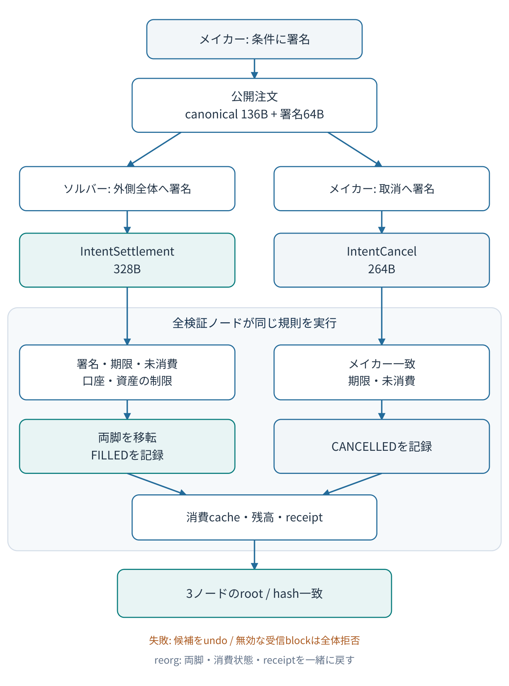

# IntentSettlement PoC 設計

> 2026-10-26 詳細仕様追加（文書版0.2、wire versionは1のまま）: [ABI台帳](poc/intent-settlement/protocol-abi.md)、[実行契約](poc/intent-settlement/execution-spec.md)、[配置案](repository-layout.md)、[受入表](acceptance-matrix.md)。実装・native照合は未実施。

文書版: 0.2 / 作成日: 2026-10-25 / 詳細化: 2026-10-26 / 状態: **実装前の提案仕様**

対象ソース: `symbol/symbol` の `6c04695555230c89a6ffa2ac4d41774dcac77ae3`。本書中の `IntentSettlement`、`IntentCancel`、専用通知・cache・API名はすべて提案名であり、現在のSymbolに存在する機能ではない。数値の取引type ID、facility ID、cache IDはまだ割り当てない。



図の編集用: [Mermaidソース](../diagrams/intent-settlement.mmd) / [SVG](../diagrams/intent-settlement.svg)。細かい成立条件とバイト形式は以下の本文を正本とする。

## 1. 目的と採用条件

メイカーが「指定した資産を指定量渡し、別の資産を指定量受け取る」という条件へ署名し、後から現れたソルバーが自己資金を使って、その条件を1つの通常トランザクションとして決済する。メイカーは注文作成後に再署名する必要がない。公開秘密鍵の中継口座P、在庫からPへの独立したfunding取引、Pからの回収取引は使わない。

外側の署名者はソルバーであり、外側の署名が資産移転を含む完成済み決済全体を認可する。メイカーの条件署名は、指定資産・数量・期限・受取口座だけを認可する。成立した決済を分割して、ソルバーの支払いだけを通常Transferとして送信できる形式にはしない。

これは**合意ルールを追加するC++ CatapultプラグインのPoC**である。隔離したprivate-netの全検証ノードとgenesis生成環境が同じ実装を使う。既存mainnet/testnetのノードへ一部導入して使うものではない。mainnetへのactivation、既存状態のmigration、旧ノードとの共存は対象外とする。

### v1の固定範囲

| 項目 | v1の決定 |
|---|---|
| 当事者 | メイカー1口座、ソルバー1口座。異なる口座とする |
| 口座認可 | 通常の単一署名口座のみ。実行時にmultisig化されていれば拒否 |
| 資産 | 異なる2つの実在するliteral mosaic ID。namespace aliasは禁止 |
| 数量 | 正の整数を最小単位で指定。両脚とも指定量ちょうど |
| 約定 | 全量を1回だけ。部分約定・複数注文マッチングは対象外 |
| メイカー受取先 | canonical order内のrecipientをメイカー自身のaddressに固定 |
| ソルバー受取先 | 外側SignerPublicKeyから導出するソルバーaddress |
| 手数料 | Settlementの通常feeはソルバーが1回負担。Cancelの通常feeはメイカー負担。独立した取引報酬はなし |
| 注文の配布 | CLIで生成した公開注文ファイルを交換。オンチェーン掲示板は必須にしない |
| 再実行防止 | 専用consumption cacheでorderIdをFILLEDまたはCANCELLEDへ遷移 |
| 取消 | メイカーが署名する新規最上位取引IntentCancel |
| 内包 | Settlement、CancelともAggregateへのembeddingを禁止 |

PoCの完成条件は、説明用シミュレーターの動作ではない。実物のC++プラグイン、取引生成・署名ツール、genesisから構築した3ノードネットワークと、状態・receipt・rollbackの統合試験結果を必要とする。

## 2. 認可と不変条件

正規チェーン上で決済が成立したとき、取引feeを別計上した資産移動は次の2本だけである。

1. メイカー → ソルバー: `giveMosaicId` を `giveAmount`。
2. ソルバー → メイカー: `getMosaicId` を `getAmount`。

給付資産または受取資産がネットワーク通貨でも、注文の数量はそのまま扱う。ソルバーの最終通貨残高には通常feeが追加で反映される。メイカーから注文fee、tip、暗黙のスプレッドを差し引かない。

守るべき不変条件は以下とする。

- メイカーの署名したcanonical orderを1byteでも変えると署名検証が失敗する。
- 資産の一方だけが確定した状態、または移転なしでFILLEDだけが確定した状態は存在しない。
- 同一orderIdは、同じブロック内・別ブロック・別ソルバーによる決済を含め1回しか消費できない。
- 取消が先に採用された注文は決済できず、決済が先に採用された注文は取消できない。
- 通常Transferと同じ口座・モザイク・残高制限を迂回しない。
- 一方の資産移転、consumption record、関連receiptは、ブロックのrollback時にすべて元へ戻る。
- 注文の公開データだけでは、ソルバーの単独送金署名を取り出せない。
- 同じgenesis、設定、ブロック列を与えた全ノードの状態rootとreceipt hashが一致する。

これらは価格の妥当性、流動性、検閲耐性、将来の発行者による資産操作まで保証するものではない。PoCが検証するのは署名条件に一致した一括決済である。

## 3. 正規化する注文binary

文字列JSONを署名対象にしない。JSONは表示・入出力用とし、署名・ID計算は次の**固定136byte**だけを使う。整数は符号なしlittle endian、公開鍵・address・nonceは表記文字列ではなくraw bytesである。paddingは明示したもの以外に追加しない。

| offset | bytes | フィールド | 規則 |
|---:|---:|---|---|
| 0 | 1 | version | `1` |
| 1 | 1 | network | 対象private-netのnetwork identifier |
| 2 | 2 | flags | `0` |
| 4 | 4 | reserved | 全byte `0` |
| 8 | 32 | makerPublicKey | Symbol標準の公開鍵 |
| 40 | 24 | recipientAddress | makerPublicKeyとnetworkから導出したaddressと完全一致 |
| 64 | 8 | giveMosaicId | literal ID、getMosaicIdと異なる |
| 72 | 8 | giveAmount | `1..u64::MAX`のうちネットワーク状態上有効な値 |
| 80 | 8 | getMosaicId | literal ID |
| 88 | 8 | getAmount | `1..u64::MAX`のうちネットワーク状態上有効な値 |
| 96 | 8 | validUntil | network epochからのミリ秒 |
| 104 | 32 | nonce | 注文識別用の32byte。CLIはCSPRNGで生成 |
| **計** | **136** | canonicalOrder | 余剰byte・不足byteを拒否 |

nonceは秘密情報ではない。合意規則として全ゼロを特別扱いしないが、通常の注文生成では新しいnonceを必ず生成する。同じ内容でnonceも同じなら同じ注文となる。整数のparseで丸め、負数のwrap、浮動小数点化を行わない。JSON表示では64bit整数を10進文字列、ID等は規定長のhexとして扱う。

### 条件署名とorderId

```
domainHash = SHA3_256(UTF8("SYMBOL_INTENT_ORDER_V1"))
message    = domainHash[32] || networkGenerationHashSeed[32] || canonicalOrder[136]
orderId    = SHA3_256(message)
signature  = SymbolEd25519.Sign(makerPrivateKey, message)
```

`message`は**200byte**。domain文字列にNUL、改行、BOMを付けない。hashはKeccak-256ではなくSHA3-256。`networkGenerationHashSeed`は接続先から無条件に採用せず、対象private-net設定に固定した値を使う。異なるgenesisの同network ID間でも再利用を拒否する。

署名は`orderId`32byteではなく、**message200byteそのもの**に対して行う。orderIdに署名64byteを含めない。これにより同じ注文に対する署名表現や外側txの違いで、再実行防止のIDが変わらない。

Catapultの既存`crypto::Sign` / `crypto::Verify`を参照し、標準実装と互換なEd25519を使う。既存`SignatureNotification`経由で検証する場合は、200byteにseedが既に含まれるため**ReplayProtectionMode::Disabled**を指定する。Enabledではseedが自動的に付加されるので、二重prependになる。直接`crypto::Verify`へ200byteを渡す実装でもよい。どちらもgolden fixtureの同一署名が通ることを必須にする。

この署名は既存Symbol通常トランザクションの署名ではなく、この新規プラグインだけが解釈する専用認可である。既存通常Transferとしては利用できない。

## 4. 最上位トランザクションの形式

両型とも標準の128byte Transaction headerを使う。headerのversionは1、networkはcanonical orderと一致、外側の署名とハッシュは標準経路で計算する。`dataBuffer`が本文全体を署名対象に含むことをテストする。追加の外部cosignatureや変更可能な署名対象外footerは設けない。

| 型 | 外側署名者 | payload | 合計size |
|---|---|---|---:|
| IntentSettlement | ソルバー | canonicalOrder136B + makerSignature64B | **328B** |
| IntentCancel | メイカー | canonicalOrder136B | **264B** |

Settlementのoffset128からorder、264からmakerSignature。Cancelのoffset128からorderを置く。orderIdは両方とも再計算し、冗長なorderIdフィールドを送らない。取引typeの数値はM0で既存登録と衝突しない私設用割当を調べ、schema・C++・ツールで共有する。`supportsTopLevel=true`、`supportsEmbedding=false`、`embeddedCount=0`とする。内部の2本は既存のembedded Transactionではなく、この型の固定セマンティクスなのでDeepCount上は最上位取引1件として扱う。

Cancelでは`outer.SignerPublicKey == order.makerPublicKey`が必須。取消自体を外側署名が認可するため、別のmakerSignatureは不要。完全なcanonical orderを含めることで、orderIdとメイカーを他人が偽って紐付ける問題を避ける。任意のorderIdだけを渡して他者注文をCANCELLEDにできるAPIにしない。

### 2種類の期限

外側Deadlineは通常取引の寿命制限を受ける。注文のvalidUntilは別の値で、外側Deadlineが過ぎた場合にソルバーは新しい外側取引を作れるが、同じ注文を期限後に復活させることはできない。

PoCでは、SettlementとCancelの実行時に次を要求する。

```
BlockTime < validUntil
validUntil - BlockTime <= 21_600_000  // 6時間、減算前に上下関係を検査
```

等号`BlockTime == validUntil`で注文は期限切れ。合意判定に実行マシンの壁時計を使わない。canonical orderに作成時刻はないため、この上限は「署名から6時間」ではない。遠い将来のvalidUntilを署名した注文は、当初は`ExpiryTooFar`で受理されず、期限の6時間前から受理可能になる。この意味をCLIと試験に明記する。より厳密な発行時刻を将来求めるなら、別versionでissuedAtを追加する。

## 5. 検証と状態更新の設計

### 5.1 Stateless検証

- payloadの厳密size、固定version、flags/reserved、networkを検査する。
- 公開鍵からrecipientを導出して一致を検査する。
- 2つのliteral mosaic ID、正の数量、異なる資産という構造を検査する。
- Settlementでは専用domain、設定されたgenesis seed、canonical orderで200byteを再構築し、maker署名を検証する。Cancelには別のmaker署名フィールドがなく、次項の外側署名で認可する。
- Cancelは外側署名者とmakerの一致を検査する。Settlementはmakerとsolverの相違を検査する。
- 外側署名は既存標準の署名経路でも必ず検査する。

### 5.2 Stateful検証

実行するブロックの時点で、期限、未消費、口座状態、mosaic状態を再確認する。RESTで先に検査した結果を合意判定の代わりに使わない。

multisig判定は、口座が他者のcosignerとして登録されているだけの状態と、その口座自身がmultisigになっている状態を区別する。v1で拒否するのは**その口座の送金権限がmultisig化されている場合**である。署名後にmakerがmultisigへ変わった場合も拒否する。

**注意:** 既存のOperationRestrictionとMultisigPermittedOperationは`TransactionNotification`を監視する。外側の通知はsolverにしか適用されない。BalanceTransferを2本発行するだけでは、makerの取引型制限が抜ける。専用validatorで両者のmultisig状態と操作制限を検査する。

v1の明示的な操作制限規則は、makerとsolver双方について、outgoingの**Transfer型とIntentSettlement型の両方が許可されること**とする。solverの外側IntentSettlement型は標準経路でも検査される。Cancelは通常の外側IntentCancel型の制限に従い、資産移転の制限は検査しない。makerの取消に残高や対象mosaicの有効性を要求しない。ただし通常feeを払えることは必要である。

住所相互制限、受取側mosaic制限、mosaicのtransferability・存続期間・global/address restrictions、残高を、既存Transfer相当の通知で検査する。Balance observerへ直接書き込んで既存validatorを迂回する実装は禁止する。操作制限の検査を流用するためだけに偽の`TransactionNotification`を追加してはならない。同じ通知に結び付くHashCacheや他のobserverも発火するためである。

### 5.3 初期残高とfee

PoCの単純化として、makerはこの取引の適用前にgiveAmountを保有し、solverはgetAmountと**outer.MaxFeeの全額**を適用前に賄えることを要求する。口座別・mosaic ID別の必要額mapを作り、getMosaicがネットワーク通貨なら両額をoverflow検査付きで合算する。受取予定の資産を先に使って不足を補うことはv1では認めない。これは既存Symbolの一般的な要件ではなく、このPoC独自の保守的な制約である。

この「適用前残高」を専用validatorで正しく確認するため、共通仕様に従いprivate-netの`TotalVotingBalanceCalculationFix`を`Height(1)`へ設定し、通常ブロックで**custom通知→fee debit**の経路を使う。設定ファイル上の正確なキー・値の表記と受理はM0で確認する。fork heightが未来の古い設定を流用すると、custom前にfeeを引いた残高へ再びMaxFeeを要求してしまうので禁止する。M0の小試験で実際の通知順をassertし、通常ブロックの先頭から対象設定が有効である証跡を残す。

実際の引き落としは標準処理が計算する`outer.Size × block.FeeMultiplier`だけ。MaxFee全額を新プラグインが引き落としたり、内部脚に別feeを請求したりしない。fee倍率0だけで成功しても受入完了としない。

### 5.4 通知の順序

以下の新規通知名は設計上の候補であり、既存APIではない。実装時は現行通知channel、observer undoの方式、factoryを読んで適切な型へ落とす。

1. `IntentAuthorizationNotification`（提案、validator channel）: canonical order、maker署名、solver、外側hash/maxFeeを渡し、構造・署名・期限・未消費・初期残高・操作制限を検査。
2. 実在する`AccountPublicKeyNotification` / `AccountAddressNotification`: 両者を正しく登録。maker公開鍵通知は専用認可の検査を通った後に置く。
3. 実在する`AddressInteractionNotification`: maker→solver、solver→makerの両方向についてTransfer相当として発行。
4. 実在する`BalanceTransferNotification`: maker→solverのgive、solver→makerのgetをこの順で発行。
5. `IntentConsumedNotification`（提案、validator＋observer channel）: orderId、FILLED、makerAddress、validUntil、height、外側hashを保存。挿入直前にも未消費を検査。
6. 外側標準経路: 通常のfee・署名通知を通常のfork設定に従って処理。

個別のBalanceTransfer通知では、その脚の制限検証→状態変更が順次行われる。2本目や最後のfee処理で失敗した場合でも、1本目だけが確定してはならない。採掘候補適用でのundoと受信ブロック拒否の両方を試験する。

Cancelは専用取消認可の検証後にCANCELLEDを保存するだけで、資産移転を発行しない。外側の通常手数料は署名者のメイカーが払う。

## 6. Consumption cacheと状態root

注文の全情報を合意状態に登録する必要はない。未消費の注文は公開署名データとして配布し、状態には終端になった注文だけを保存する。

| 要素 | 内容 |
|---|---|
| key | orderId 32byte |
| status | `1=FILLED`、`2=CANCELLED`。他値は不正 |
| makerAddress | 24byte |
| validUntil | u64 |
| consumedHeight | u64 |
| outerTransactionHash | 32byte |

cache valueのcanonical serializerは、status1B、reserved7B、makerAddress24B、validUntil8B、consumedHeight8B、outerTransactionHash32Bの**80B**とする。整数はLE、reservedは0。メモリ構造体の暗黙paddingをhashしない。Patricia/Merkle対応のsub-cacheを登録し、格納順序に依存せず同じrootを得る。

既存cacheにない注文はOPEN。照会時に`BlockTime >= validUntil`ならEXPIREDと導出する。保存済みFILLED/CANCELLEDは期限後もその状態を返す。OPENは「現在必ず実行可能」という意味ではなく、残高・制限・ExpiryTooFarなどの可否理由を別フィールドで返す。

PoCでは終端レコードをpruneしない。期限切れ直後の削除は深いrollbackや再検証と競合し得るため、履歴保持とpruningは別設計にする。

**新しいMerkle対応cacheを追加すると、stateHashを構成するcache root群にも影響する。** nemgenと3ノードに同じプラグイン・cache登録・設定を入れ、対応するgenesisから生成し直す。既存mainnetの9本rootという前提をそのまま使わない。baselineと導入後のroot構成・cache ID・空cache root・genesis hashをテスト成果物に記録する。機能を入れたノードだけ別stateHashを出す状態を成功とみなさない。

### commit、undo、reorg

commitではOPENから終端レコードを1件insertする。rollbackでは、その取引が作成したレコードと移転を逆順に戻し、注文を元の未登録状態にする。別の取引のレコードを誤って削除しないよう、orderId・status・height・outerHashの一致を不変条件として検査する。

同一ブロックに2回の消費があれば、1件目のdeltaが2件目の検証に見える必要がある。プロセス終了前だけ記憶するset、ソルバーのローカルDB、REST上の既約定検索で代用しない。

## 7. 失敗、取消競争、分岐

| 状況 | 必須の挙動 |
|---|---|
| maker署名不正 | Settlementを拒否。資産・consumptionに変化なし |
| 第2脚だけ残高／制限不正 | Settlement全体を拒否。第1脚も残らない |
| settle→settle | 先行のみ有効、後行はAlreadyFilled |
| cancel→settle | 先行取消のみ有効、後行はAlreadyCancelled |
| settle→cancel | 先行約定のみ有効、後行はAlreadyFilled |
| cancel→cancel | 先行のみ有効。別外側hashでも再取消は拒否 |
| 候補作成時の失敗 | 外側1件全体をundoし、その候補を外せる |
| 無効な外側を含む受信ブロック | **ブロック全体を拒否**。チャンクだけ捨てて残りを採用しない |
| 未finalizedの決済ブロックをrollback | 資産、consumption、receiptが先行状態へ戻る |
| rollback後の別ソルバーによる再約定 | 期限と他条件を満たせば可能。二重の確定残高は生じない |

優先順位はブロック内で確定する順序だけで決まり、ローカルで先に取消を送信したという事実だけでは保証しない。CLIはbroadcast、unconfirmed、confirmed、finalizedを区別し、取消送信直後に取消済みと表示しない。

## 8. ツールと照会APIの候補

実装はまずCLIで署名からアナウンスまでを再現できるようにする。名称は提案で、対象repoの実在するbuild・SDK・REST構造に合わせる。

- `intent-order create`: 対象ネットワーク、2資産、整数数量、validUntilからcanonical bytesとmaker署名を生成。秘密鍵は出力しない。
- `intent-order inspect/verify`: canonical bytes、200byte message、orderId、表示数量、検証結果を出す。公開データだけで動く。
- `intent-settle build/announce`: 同じ注文を受け取り、solverが外側を署名。未確認のseedやnetworkに送らない。
- `intent-cancel build/announce`: makerがcanonical orderを含むCancelに署名。
- `intent-status`: 固定height/hashと注文データを指定して、合意cache状態と実行可能性を照会。

候補RESTは`GET /experimental/intents/{orderId}`と`POST /experimental/intents/status`。前者は保存済みレコードまたはUNKNOWNを返す。**未知のorderIdだけではvalidUntilが分からないため、OPEN/EXPIREDを断定しない。** 後者はcanonical orderと署名を受け、指定または応答中で明示したブロック時点でOPEN/EXPIRED等を導出する。POSTだが状態を書き換えない照会とする。

RESTは任意の便利機能であり、合意処理は各ノードが再検証する。既存RESTにこれらのルートがあると仮定しない。実際に実装した場合はroute登録、schema、cache読取、height整合性までテストする。未実装ならCLIとintegrationの直接cache照会を使い、文書に未実装と記す。

## 9. 実装工程と通過条件

| 段階 | 作業 | 通過条件 |
|---|---|---|
| M0 | repoのAGENTS、build/test、schema生成、nemgen、plugin登録、cache/serializerの既存例を実読 | baseline一致、私設ID割当、build手順、実在APIとの対応表を記録 |
| M1 | canonical serializer、署名、ID、両型のschemaとC++構造 | 固定sizeとcross-language golden fixture一致 |
| M2 | 新TransactionPlugin、stateless/stateful validators、既存transfer通知への接続 | 無効署名・制限・残高・feeを含む実C++ unit tests |
| M3 | consumption cache、commit/undo、永続化、root計算 | 重複・取消・再起動・異なる挿入順の検証 |
| M4 | CLI、3ノードprivate-net、専用genesis | 非ゼロfeeの正常約定／取消を全ノードが同じhashで受理 |
| M5 | 競争、失敗候補undo、受信無効block、fork/reorg | 資産・状態root・receipt・consumptionが仕様どおり |
| M6 | 再現手順・raw証跡・既知限界 | 別環境で最初から再実行できる |

M0で型を追加するだけでは正しいobserverやcacheへ接続できないと判明した場合は、必要な最小のコア変更を理由とともに分離する。プラグインだけで可能だと証明するために検査を省かない。

## 10. テスト計画

| ID | 試験 | 期待結果 |
|---|---|---|
| IS-01 | serializerの全offset、136/200/328/264B | 完全一致、余剰byte拒否 |
| IS-02 | fixtureをC++と独立ツールで署名・検証 | 同じmessage/orderId、標準C++で署名検証成功 |
| IS-03 | field改変、wrong seed/network、domain、二重seed | すべて拒否。署名にIDだけを使う実装も不一致 |
| IS-04 | flags/reserved、0 amount、同mosaic、alias | 拒否 |
| IS-05 | expiryの前1ms・同値・後1ms、6h境界 | 規定のstrict expiryとupper capに一致 |
| IS-06 | fee倍率非ゼロ、give/getそれぞれがXYM | maker数量は固定、solverだけ実fee1回 |
| IS-07 | maker/solver残高不足、MaxFee合算overflow | 全体拒否、全状態不変 |
| IS-08 | maker/solverの実行直前multisig化 | 両方拒否。単なる他口座cosigner登録と区別 |
| IS-09 | 両者のTransfer/Settlement操作制限 | どの拒否条件も迂回不可 |
| IS-10 | 住所制限、受取mosaic制限、mosaic global/address制限 | 通常Transferと同じ可否 |
| IS-11 | 存在しない／期限切れ／非transferable mosaic | 前2者は拒否。非transferableはownerが送受信者かによる例外を含め通常Transferと同じ可否 |
| IS-12 | 2ソルバーが同注文を同block／別blockで実行 | 1回のみ。外側hash違いで再実行不可 |
| IS-13 | cancel/settleの両順、再取消、他人のCancel | 包含順の先行だけ成立、他人は拒否 |
| IS-14 | 1脚目適用後の後段validator失敗 | C++ pipeline試験で1脚目observe後に失敗を注入し、UT undoで全資産・cache・receiptが元通り。integrationでも無効注文の前後不変を確認 |
| IS-15 | 不正Settlementを含む受信block | block全体拒否、先行正当txの状態もcommitしない |
| IS-16 | 非finalized blockのrollbackと別枝で再約定 | consumption削除・資産復元・再実行が一致 |
| IS-17 | FILLED/CANCELLED後に全ノード再起動 | 状態維持、再消費拒否、root一致 |
| IS-18 | fresh genesisと全nodeのstateHash構成 | 新cache含めroot構成・genesis一致 |
| IS-19 | プラグインなしの隔離ノードへ新型を渡す | 受理不可を確認。既存網互換と誤認しない |
| IS-20 | 取引取り出し・並べ替え・再包装 | 署名済み単独fundingとして再利用不能 |

モデル上の試験とCatapult実行試験を別欄に記録する。各IDに実行コマンド、コミット、設定、exit code、raw log、tx/block hash、前後残高、状態root・receipt hashを紐付ける。IS-14の故意の失敗注入はtest harness限定とし、本番プラグインに検査回避用の設定を作らない。まだ実行していない項目はNOT RUNとする。状態遷移をPythonだけで模倣してPASSにしない。

## 11. 参照した公式ソース

以下はすべて固定baselineへのリンクである。M0ではリンク先の実ファイルと周辺testを改めて読む。

- [PluginManager.h](https://github.com/symbol/symbol/blob/6c04695555230c89a6ffa2ac4d41774dcac77ae3/client/catapult/src/catapult/plugins/PluginManager.h): 取引、validator、observer、cacheの拡張点。
- [TransactionPlugin.h](https://github.com/symbol/symbol/blob/6c04695555230c89a6ffa2ac4d41774dcac77ae3/client/catapult/src/catapult/model/TransactionPlugin.h): 署名対象buffer、embedding、通知context。
- [Transaction.h](https://github.com/symbol/symbol/blob/6c04695555230c89a6ffa2ac4d41774dcac77ae3/client/catapult/src/catapult/model/Transaction.h): 標準128byte header。
- [NotificationPublisher.cpp](https://github.com/symbol/symbol/blob/6c04695555230c89a6ffa2ac4d41774dcac77ae3/client/catapult/src/catapult/model/NotificationPublisher.cpp): 外側のfee、deadline、署名、固有通知の順序。
- [Signer.h](https://github.com/symbol/symbol/blob/6c04695555230c89a6ffa2ac4d41774dcac77ae3/client/catapult/src/catapult/crypto/Signer.h): 標準Sign/Verify。
- [TransferTransactionPlugin.cpp](https://github.com/symbol/symbol/blob/6c04695555230c89a6ffa2ac4d41774dcac77ae3/client/catapult/plugins/txes/transfer/src/plugins/TransferTransactionPlugin.cpp): AddressInteractionとBalanceTransfer通知。
- [OperationRestrictionValidator.cpp](https://github.com/symbol/symbol/blob/6c04695555230c89a6ffa2ac4d41774dcac77ae3/client/catapult/plugins/txes/restriction_account/src/validators/OperationRestrictionValidator.cpp): 外側だけではmakerに適用されない操作制限。
- [MultisigPermittedOperationValidator.cpp](https://github.com/symbol/symbol/blob/6c04695555230c89a6ffa2ac4d41774dcac77ae3/client/catapult/plugins/txes/multisig/src/validators/MultisigPermittedOperationValidator.cpp): multisig口座自体からの通常操作禁止。
- [MosaicRestrictionBalanceValidator.cpp](https://github.com/symbol/symbol/blob/6c04695555230c89a6ffa2ac4d41774dcac77ae3/client/catapult/plugins/txes/restriction_mosaic/src/validators/MosaicRestrictionBalanceValidator.cpp): 送受信双方のmosaic restriction。
- [HarvestingUtFacadeFactory.cpp](https://github.com/symbol/symbol/blob/6c04695555230c89a6ffa2ac4d41774dcac77ae3/client/catapult/extensions/harvesting/src/HarvestingUtFacadeFactory.cpp): 候補取引のapply/undo。
- [BatchEntityProcessor.cpp](https://github.com/symbol/symbol/blob/6c04695555230c89a6ffa2ac4d41774dcac77ae3/client/catapult/src/catapult/chain/BatchEntityProcessor.cpp): block内の逐次検証と失敗。

設計図は[diagrams/intent-settlement.mmd](../diagrams/intent-settlement.mmd)、実装依頼文は[codex/intent-settlement-task.md](../codex/intent-settlement-task.md)を参照。
